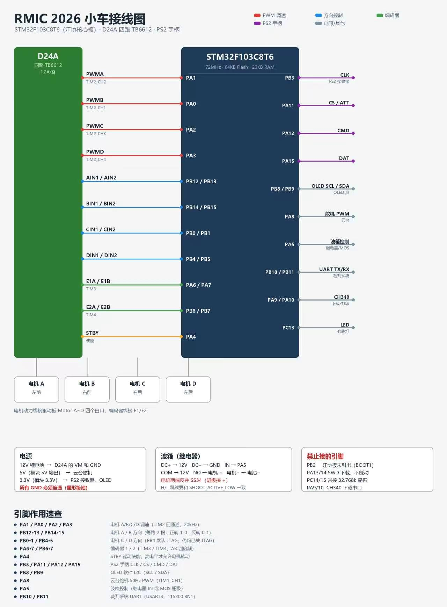

# RM Campus Kami Team

这是来自神之队的第一次 RM 经历，记录 RMIC 2026 校赛小车的固件、结构图纸和硬件资料。

## 仓库结构

| 目录 | 内容 |
| --- | --- |
| [`firmware/小车测试1`](firmware/小车测试1) | STM32F103 Keil 固件工程，包含电机、底盘、PS2 手柄、OLED、裁判系统等功能 |
| [`hardware/开源图纸`](hardware/开源图纸) | 小车开源结构图纸，包含 STL、STEP 和 3MF 文件 |
| [`docs/hardware`](docs/hardware) | 硬件接线与系统说明 |

## 固件

使用 Keil 打开 `firmware/小车测试1/project.uvprojx`。当前工程实现 PS2 无线手柄控制、麦克纳姆轮底盘运动、编码器反馈、OLED 调试界面、舵机、发射机构和裁判系统通信。

详细接线和操作说明见 [`firmware/小车测试1/README.md`](firmware/小车测试1/README.md)。

## 硬件接线

主控为 STM32F103C8T6，电机驱动为 D24A（四路 TB6612），接收器为 PS2 手柄接收器。

